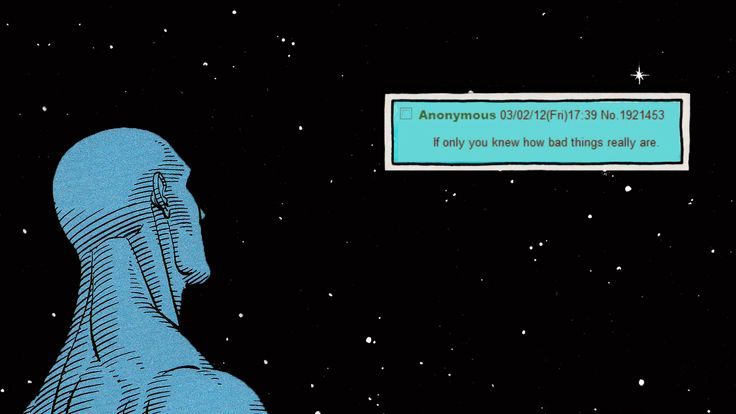
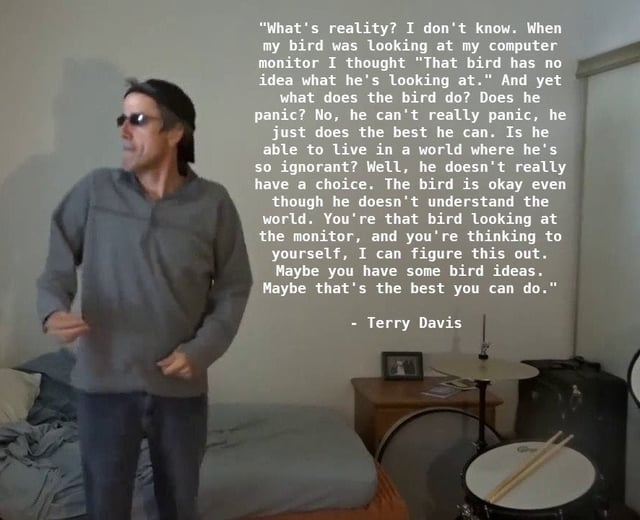

**Education**

I completed my B.Tech Computer Science from PES University in 2026. 
I worked as an intern and now as a full time employee in HPE Networking.
For the past 8 months I've been working on Junos OS which is a networking operating system running on many juniper devices. it was derived from FreeBSD.

I'm interested in systems programming, history of computer science and math.

why learn ?

[yt link](https://youtu.be/tYOlvdNq9UI?si=jDXUv_CFGcxg8Gph)

it's just like mmap(2) but it's for taking nap's instead of mapping memory.
