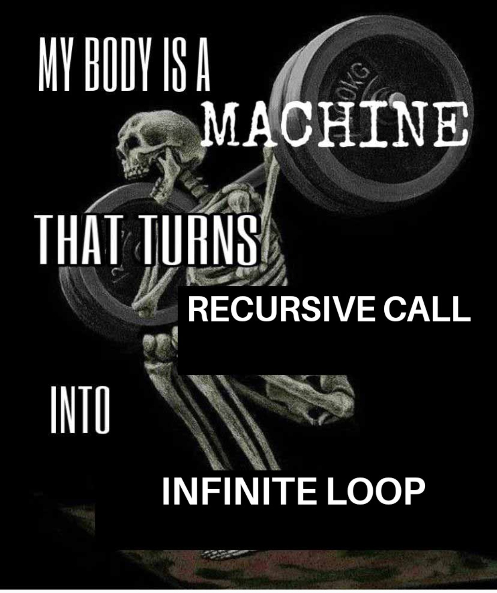
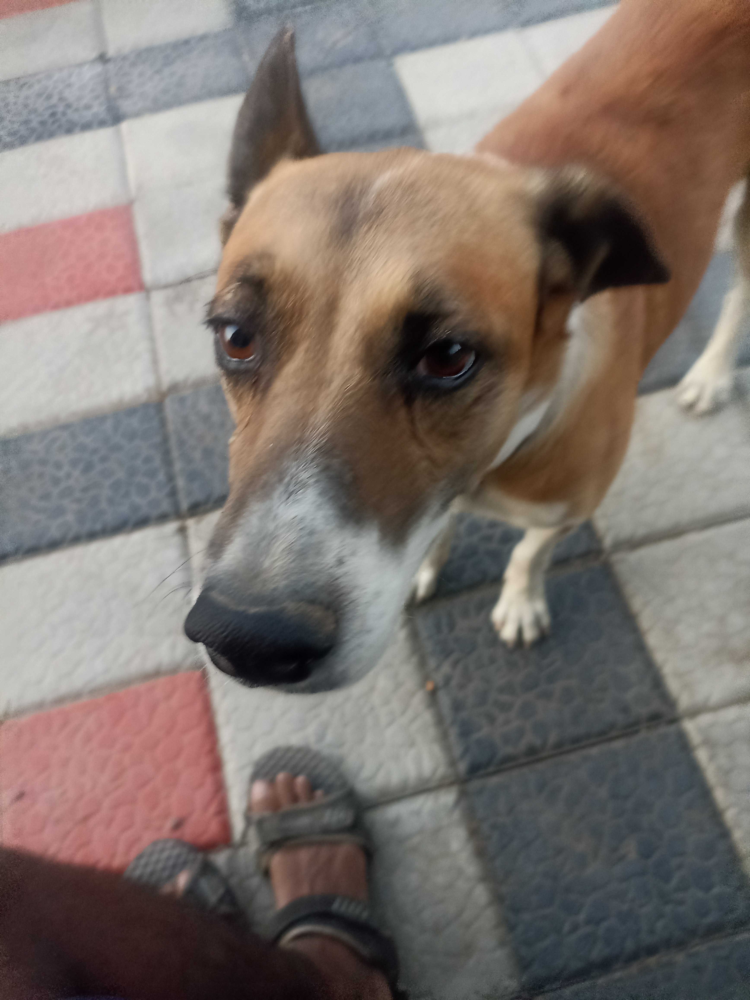
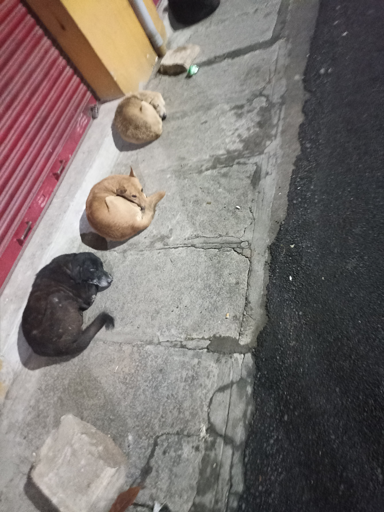
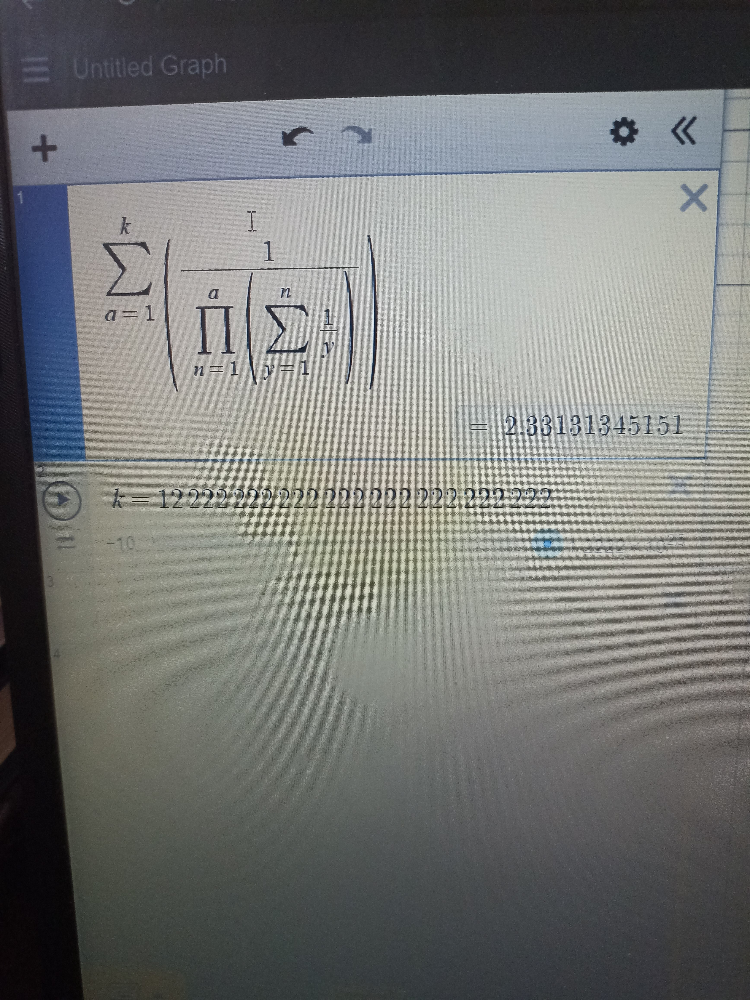

# Here are some memes I made and some random images i took when I was bored

*You have understood the concept if you can make a 
meme out of it*

- Don't know who 

These  memes I made when was learning something and was not interested in taking notes.

this was during my machine learning course 

sql meme

Doggo

Doggos

I was just trying out desmos and found this one nice converging sum.

Peter Griffin I drew in keep notes app

"TOP SECURITY" lol 

